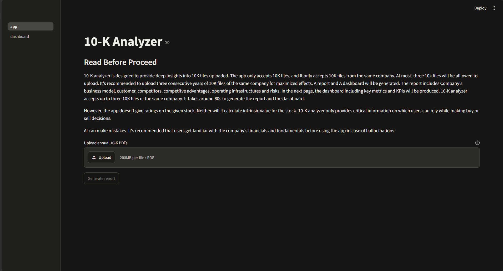
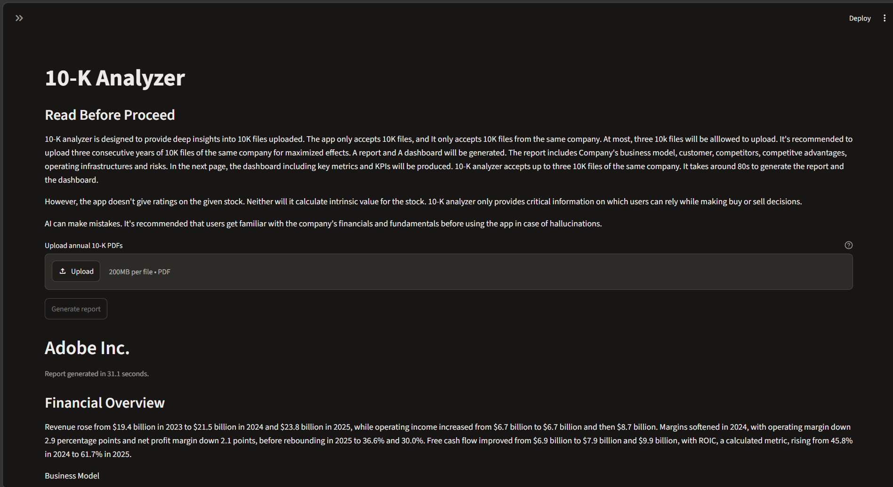
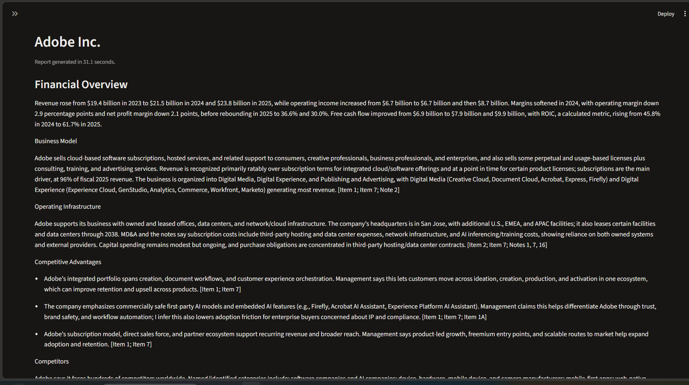
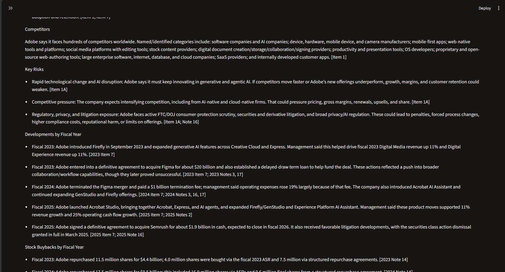
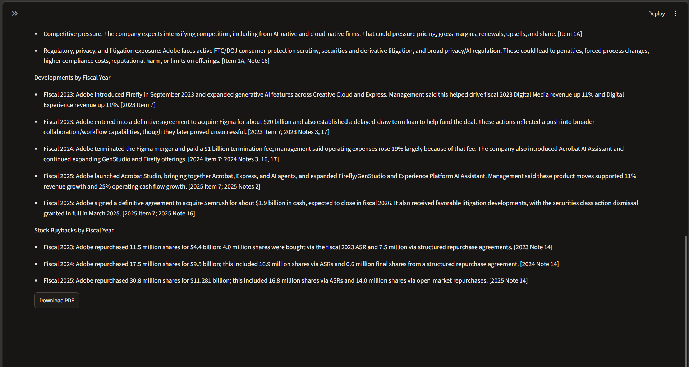
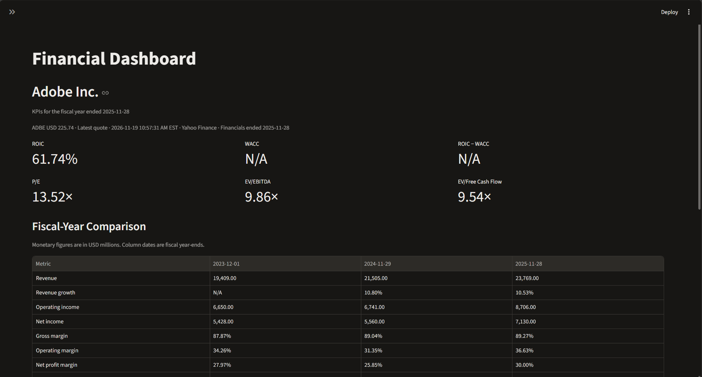
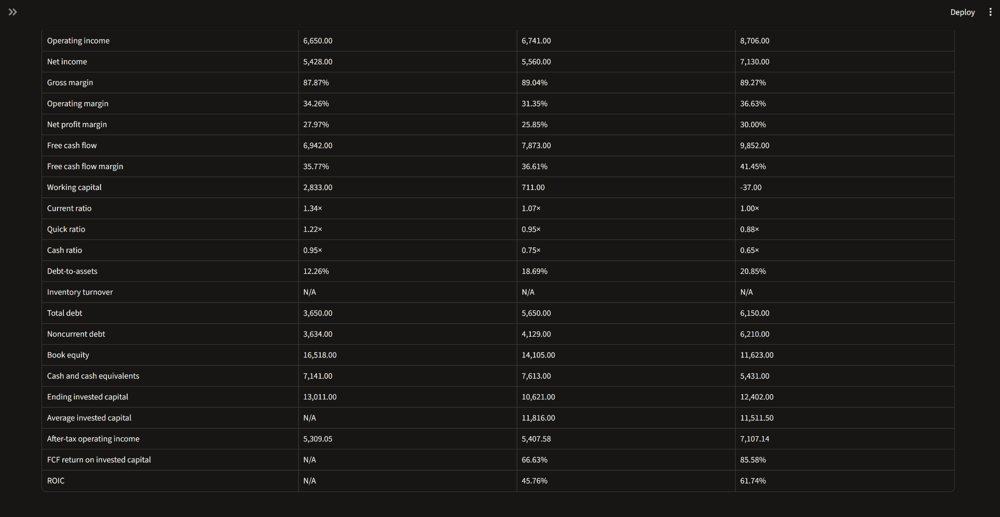

## 10K Analyzer
#### The APP
<p> 
The app receives at most three 10K files of the same company.
It extracts insights from those reports and turn it to a 
a report and a dashboard with key metrics and KPIS
such as ROIC, FCF, PE and EV/EBITDA and much more. It provide informations investors can use to make investment decisons.
</p>

#### Tech Stack
<ul>
<li>Python</li>
<li>OpenAI API</li>
<li>FastAPI</li>
<li>Docker</li>
<li>CI/CD pipeline</li>
<li>Github/Github Action</li>
<li>AWS Lightsail</li>
</ul>

#### Run the APP with Docker locally
```bash
# you do need your own OpenAI API key to run the app
# 1. clone repository
cd ~desktop
git clone https://github.com/kun-2023/10K-Analyzer.git
cd 10K-Analyzer
# 2 copy .env.example file
cp .env.example .env
# fill in .env file with your openai_api key
# 3. build docker images
# turn on Desktop Docker
docker compose up --build
# 3. Go to the local app at browser
http://localhost:8502
```

#### Demo Screenshots of Analysis on ABDE













